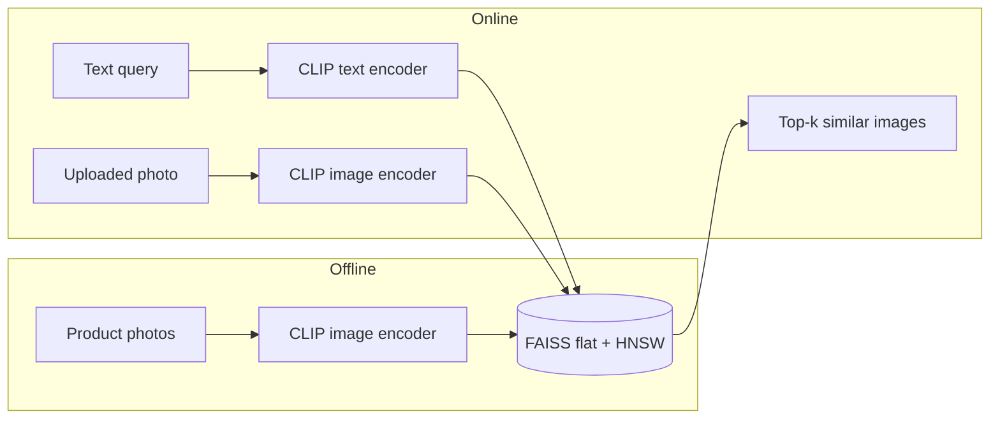

# Visual Furniture Search Engine

Search a furniture catalogue **by describing it** ("grey 3-seater sofa") **or by uploading a photo**. Images and text are embedded into one shared space with **OpenAI CLIP**, stored in a **FAISS** vector index, and served through a **FastAPI** REST API and a **Streamlit** demo.

## Highlights

- **Multimodal search:** one embedding space handles text-to-image and image-to-image queries.
- **Leakage-free evaluation:** test products are searched against a catalogue of *different* products, so a query can never find another photo of itself.
- **Two retrieval tests:** category retrieval, and a harder same-product test (find the other photos of the same item).
- **Two FAISS indexes:** exact (flat) as the accuracy reference and approximate HNSW for speed, with HNSW recall measured against exact search.
- **Honest latency breakdown:** vector search time and CLIP encoding time are reported separately, because encoding usually dominates.
- **Tested:** 26 unit tests run the whole pipeline (indexing, search, evaluation, dataset handling, API) with a fake embedder, so they need no model download.

## How it works



Vectors are L2-normalised, so inner product equals cosine similarity.

## Dataset

The project uses the **ABO furniture subset** on Hugging Face ([marco-willi/abo_furniture](https://huggingface.co/datasets/marco-willi/abo_furniture)), a curated slice of the Amazon Berkeley Objects dataset:

- 25,352 product photos (224x224 JPEG), 6 categories: bed, chair, lamp, sofa, storage, table
- Several photos (views) per product, with a train / val / test split made **by product**
- License: **CC BY-NC 4.0** (non-commercial). Cite: Collins et al., *ABO: Dataset and Benchmarks for Real-World 3D Object Understanding*, CVPR 2022
- Class imbalance is real: chairs outnumber beds about 7 to 1

```bash
python -m src.prepare_abo      # downloads about 224 MB and arranges data/images/
```

You can also use your own photos arranged one folder per category (`data/images/<category>/<image>.jpg`); the code detects the layout automatically. Images are git-ignored because you may not redistribute them.

## Quick start

```bash
git clone https://github.com/muhammadammar5/Visual-Furniture-Search-CLIP.git
cd Visual-Furniture-Search-CLIP
python -m venv .venv
source .venv/bin/activate        # Windows: .venv\Scripts\activate
pip install -r requirements.txt

python -m src.prepare_abo                          # download the dataset
python -m src.build_index --max-images 2000        # quick trial first (a few minutes on CPU)
python -m src.build_index                          # full run: embed all images, build FAISS indexes
python -m src.evaluate                             # quality metrics -> results/
python -m src.benchmark embed                      # CLIP encoding latency
python -m src.benchmark ann                        # exact vs HNSW scaling (synthetic)

streamlit run app.py                               # demo UI
uvicorn src.api:app --reload                       # REST API at http://localhost:8000/docs
```

Embedding 25,000 images takes roughly 15 to 30 minutes on a laptop CPU and 1 to 3 minutes on a free Colab GPU (`notebooks/run_on_colab.ipynb`). Searching is fast on any machine.

## API

```bash
curl -X POST http://localhost:8000/search/text \
  -H "Content-Type: application/json" \
  -d '{"query": "grey 3-seater sofa", "k": 5}'

curl -X POST "http://localhost:8000/search/image?k=5" -F "file=@my_sofa.jpg"
```

Each result has `rank`, `category`, `score`, `path` and `image_url`, and the response includes `timings_ms` for encoding and search.

## Evaluation

With the ABO dataset the **split protocol** is used:

- **Catalogue:** train + val photos. **Queries:** test photos (products the catalogue has never seen).
- **Category retrieval:** a result is correct if it has the same category as the query.
- **Same-product retrieval:** among the test photos only, given one photo of a product, find its other photos. This is much harder than category matching and tests fine-grained matching.
- **Text queries:** "a photo of a <category>" for every category, plus your own list in `eval/text_queries.json` (copy `eval/text_queries.example.json`).

For plain folder datasets it falls back to leave-one-out retrieval (the query is excluded from its own results).

| Metric | Meaning |
|---|---|
| hit@k | at least one correct result in the top k |
| precision@k | share of the top k that are correct |
| MRR@10 | average of 1 / rank of the first correct result |
| HNSW recall@10 | overlap of HNSW and exact top-10 results |

### Results

> Fill in from `results/retrieval_metrics.json` and the benchmark files after your run. Do not quote numbers you did not measure.

**Catalogue:** _TBD_ images | **Queries:** _TBD_ test photos | **Categories:** 6

| Task | hit@1 | hit@5 | precision@5 | MRR@10 |
|---|---|---|---|---|
| Image to image (category) | _TBD_ | _TBD_ | _TBD_ | _TBD_ |
| Same-product retrieval | _TBD_ | _TBD_ | _TBD_ | _TBD_ |
| Text to image (category prompts) | _TBD_ | _TBD_ | _TBD_ | _TBD_ |
| Text to image (custom queries) | _TBD_ | _TBD_ | _TBD_ | _TBD_ |

CLIP zero-shot classification accuracy: _TBD_. HNSW recall@10 vs exact: _TBD_.

| Latency (ms, median) | Value |
|---|---|
| CLIP text encoding | _TBD_ |
| CLIP image encoding | _TBD_ |
| FAISS flat search | _TBD_ |
| FAISS HNSW search | _TBD_ |

### Reading the results honestly

- **Category match is an easy test.** A result in the right category can still look nothing like the query (wrong colour or style). The same-product test and a visual check of results give a fuller picture.
- **Search time is not query time.** Vector search takes well under a millisecond on thousands of images; encoding the query with CLIP takes much longer. Quote them separately.
- **Class imbalance.** Beds are rare in this dataset, so overall averages are dominated by chairs. Check per-category behaviour by eye in the demo.
- The `ann` benchmark uses **synthetic** vectors to show how exact and approximate search scale. It is not a statement about your data. HNSW trades recall for speed through its search depth: try `python -m src.benchmark ann --ef-search 256` to see recall rise and speed fall.

## Project structure

```
src/
  config.py            constants
  prepare_abo.py       download and arrange the ABO dataset
  dataset.py           folder scanner and ABO metadata loader
  embedder.py          CLIP image and text encoders
  index.py             FAISS flat / HNSW / IVF wrapper
  build_index.py       embed everything and build the indexes
  search.py            text and image search
  evaluate.py          retrieval quality and ANN recall
  benchmark.py         encoding and index-scaling speed
  api.py               FastAPI service
app.py                 Streamlit demo
tests/                 26 tests
eval/                  example text queries
notebooks/             Colab runner
```

## Limitations and future work

- CLIP is general-purpose; fine-tuning on furniture data would improve colour and style matching.
- Search matches appearance, not price, size or stock. A real catalogue would combine it with metadata filters.
- Photos are 224x224 centre crops, which loses detail.
- Ideas: re-ranking with attributes, a larger CLIP model, product metadata from vendor APIs, and a human-judged relevance set.

## License

MIT for this repository's code. The ABO images are CC BY-NC 4.0 (non-commercial use only).
